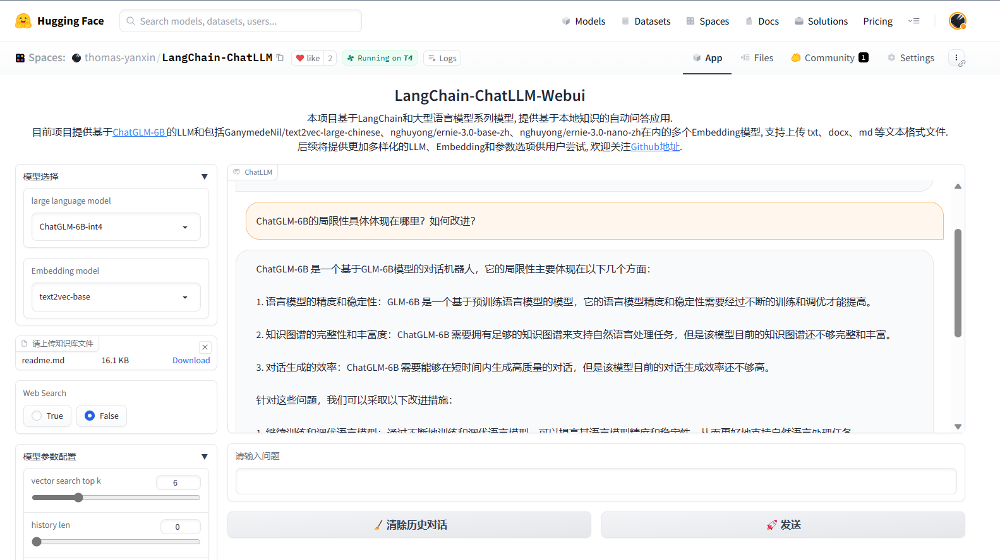
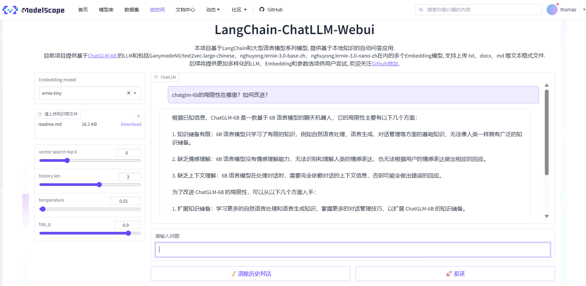

 <p align="center">
  <a href="https://github.com/thomas-yanxin/LangChain-ChatGLM-Webui"></a>
  <a href="https://huggingface.co/spaces/thomas-yanxin/LangChain-ChatLLM"></a>
  <a href="https://modelscope.cn/studios/AI-ModelScope/LangChain-ChatLLM/summary"></a>
  <a href="https://openxlab.org.cn/apps/detail/thomas-yanxin/LangChain-ChatLLM"></a> 
  <a href="https://openi.pcl.ac.cn/Learning-Develop-Union/LangChain-ChatGLM-Webui"></a>
  <a href="https://aistudio.baidu.com/aistudio/projectdetail/6195067"></a>
   <a href="https://www.bilibili.com/video/BV1So4y1L7Hb/?share_source=copy_web&vd_source=8162f92b2a1a94035ca9e4e0f6e1860a"></a> 

</p> 
<div align="center">

 [](https://github.com/thomas-yanxin/LangChain-ChatGLM-Webui/graphs/contributors) [](https://github.com/thomas-yanxin/LangChain-ChatGLM-Webui/issues) [](https://github.com/thomas-yanxin/LangChain-ChatGLM-Webui/pulls)

</p>
</div>

<p align="center">  
   <a href="https://www.bilibili.com/video/BV1So4y1L7Hb/?share_source=copy_web&vd_source=8162f92b2a1a94035ca9e4e0f6e1860a"><strong>视频链接</strong></a> | <a href="https://huggingface.co/spaces/thomas-yanxin/LangChain-ChatLLM"><strong>在线体验</strong></a> | <a href="https://github.com/thomas-yanxin/LangChain-ChatGLM-Webui/blob/master/docs/deploy.md"><strong>部署文档</strong></a>| <a href="https://github.com/thomas-yanxin/LangChain-ChatGLM-Webui/blob/master/docs/update_history.md"><strong>更新日志</strong></a> | <a href="https://github.com/thomas-yanxin/LangChain-ChatGLM-Webui/blob/master/docs/faq.md"><strong>常见问题</strong></a> 

</p>

## 🔥 项目体验

本项目提供基于[HuggingFace社区](https://huggingface.co/spaces/thomas-yanxin/LangChain-ChatLLM)、[OpenXLab](https://openxlab.org.cn/apps/detail/thomas-yanxin/LangChain-ChatLLM)、[ModelScope魔搭社区](https://modelscope.cn/studios/AI-ModelScope/LangChain-ChatLLM/summary)、[飞桨AIStudio社区](https://aistudio.baidu.com/aistudio/projectdetail/6195067)的在线体验, 欢迎尝试和反馈!  

## 👏 项目介绍

受[langchain-ChatGLM](https://github.com/imClumsyPanda/langchain-ChatGLM)启发, 利用LangChain和ChatGLM-6B系列模型制作的Webui, 提供基于本地知识的大模型应用.

目前支持上传 txt、docx、md、pdf等文本格式文件, 提供包括ChatGLM-6B系列、Belle系列等模型文件以及[GanymedeNil/text2vec-large-chinese](https://huggingface.co/GanymedeNil/text2vec-large-chinese)、[nghuyong/ernie-3.0-base-zh](https://huggingface.co/nghuyong/ernie-3.0-base-zh)、[nghuyong/ernie-3.0-nano-zh](https://huggingface.co/nghuyong/ernie-3.0-nano-zh)等Embedding模型.

<details><summary><b>HuggingFace效果</b></summary>



</details>
<details><summary><b>ModelScope效果</b></summary>



</details>

## 🚀 使用方式

提供ModelScope版本和HuggingFace版本.  
**需要Python>=3.8.1**  

详细部署教程可参考: [部署文档](./docs/deploy.md) | [视频教程](https://www.bilibili.com/video/BV1No4y1b7eu/)

### 支持模型

若存在网络问题可在[此找到本项目涉及的所有模型](https://openi.pcl.ac.cn/Learning-Develop-Union/LangChain-ChatGLM-Webui/datasets):   
| large language model | Embedding model |
| :----: | :----: |
| ChatGLM-6B | text2vec-large-chinese |
| ChatGLM-6B-int8 | ernie-3.0-base-zh |
| ChatGLM-6B-int4 | ernie-3.0-nano-zh |
| ChatGLM-6B-int4-qe | ernie-3.0-xbase-zh |
| Vicuna-7b-1.1 | simbert-base-chinese |
| Vicuna-13b-1.1 | paraphrase-multilingual-MiniLM-L12-v2 |
| BELLE-LLaMA-7B-2M |  |
| BELLE-LLaMA-13B-2M | |
| internlm-chat-7b-8k | |
| internlm-chat-7b-v1_1 | |
| internlm-chat-7b | |
| [MiniMax-M2.7](https://platform.minimaxi.com/) (Cloud API) | |
| [MiniMax-M2.7-highspeed](https://platform.minimaxi.com/) (Cloud API) | |

> **MiniMax Cloud LLM**: 除本地模型外，项目还支持通过 [MiniMax](https://platform.minimaxi.com/) 云端API调用大语言模型，无需GPU即可使用。设置环境变量 `MINIMAX_API_KEY` 后，在模型选择下拉框中选择 MiniMax-M2.7 或 MiniMax-M2.7-highspeed 即可。

## 💪 更新日志

详情请见: [更新日志](./docs/update_history.md)

项目处于初期阶段, 有很多可以做的地方和优化的空间, 欢迎感兴趣的社区大佬们一起加入!

## ❤️ 引用

1. [ChatGLM-6B](https://github.com/THUDM/ChatGLM-6B): ChatGLM-6B: 开源双语对话语言模型
2. [LangChain](https://github.com/hwchase17/langchain): Building applications with LLMs through composability
3. [langchain-ChatGLM](https://github.com/imClumsyPanda/langchain-ChatGLM): 基于本地知识的 ChatGLM 应用实现
<details><summary><b>ChatGLM论文引用</b></summary>

```
@inproceedings{
  zeng2023glm-130b,
  title={{GLM}-130B: An Open Bilingual Pre-trained Model},
  author={Aohan Zeng and Xiao Liu and Zhengxiao Du and Zihan Wang and Hanyu Lai and Ming Ding and Zhuoyi Yang and Yifan Xu and Wendi Zheng and Xiao Xia and Weng Lam Tam and Zixuan Ma and Yufei Xue and Jidong Zhai and Wenguang Chen and Zhiyuan Liu and Peng Zhang and Yuxiao Dong and Jie Tang},
  booktitle={The Eleventh International Conference on Learning Representations (ICLR)},
  year={2023},
  url={https://openreview.net/forum?id=-Aw0rrrPUF}
}
```

```
@inproceedings{du2022glm,
  title={GLM: General Language Model Pretraining with Autoregressive Blank Infilling},
  author={Du, Zhengxiao and Qian, Yujie and Liu, Xiao and Ding, Ming and Qiu, Jiezhong and Yang, Zhilin and Tang, Jie},
  booktitle={Proceedings of the 60th Annual Meeting of the Association for Computational Linguistics (Volume 1: Long Papers)},
  pages={320--335},
  year={2022}
}
```

</details>
<details><summary><b>BELLE论文引用</b></summary>

```
@misc{BELLE,
  author = {Yunjie Ji, Yong Deng, Yan Gong, Yiping Peng, Qiang Niu, Baochang Ma and Xiangang Li},
  title = {BELLE: Be Everyone's Large Language model Engine },
  year = {2023},
  publisher = {GitHub},
  journal = {GitHub repository},
  howpublished = {\url{https://github.com/LianjiaTech/BELLE}},
}
@article{belle2023exploring,
  title={Exploring the Impact of Instruction Data Scaling on Large Language Models: An Empirical Study on Real-World Use Cases},
  author={Yunjie Ji, Yong Deng, Yan Gong, Yiping Peng, Qiang Niu, Lei Zhang, Baochang Ma, Xiangang Li},
  journal={arXiv preprint arXiv:2303.14742},
  year={2023}
}
```

</details>

## 🙇‍ ‍感谢

1. [langchain-ChatGLM](https://github.com/imClumsyPanda/langchain-ChatGLM)提供的基础框架
2. [魔搭ModelScope](https://modelscope.cn/home)提供展示空间
3. [OpenI启智社区](https://openi.pcl.ac.cn/)提供调试算力
4. [langchain-serve](https://github.com/jina-ai/langchain-serve)提供十分简易的Serving方式
5. 除此以外, 感谢来自社区的同学们对本项目的关注和支持!
<a href="https://github.com/thomas-yanxin/LangChain-ChatGLM-Webui/graphs/contributors">
  
</a>

## 🌟 Star History

[](https://star-history.com/#thomas-yanxin/LangChain-ChatGLM-Webui&Date)

## 😊 加群沟通

<div>  </div>
